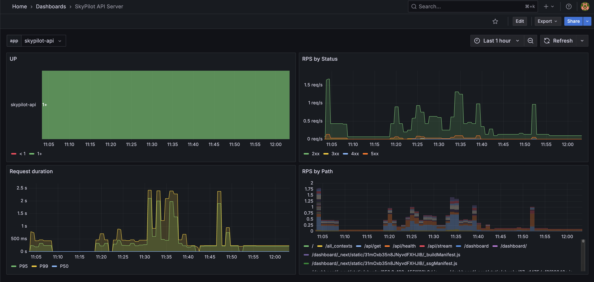

.. _api-server-metrics-setup:

Monitoring SkyPilot API Server Metrics
======================================

SkyPilot API Server can export Prometheus-compatible metrics and
optionally deploy a *one-click* Prometheus + Grafana stack so that you get
a fully functional monitoring solution out of the box.

.. tip::

   Metrics are **disabled by default**.  All the
   knobs described below can be set via ``helm upgrade`` during the initial
   installation or a later upgrade.

Quickstart: enable the full metrics stack
-----------------------------------------

If you do not already have Prometheus or Grafana running, the quickest way to get started is to let the SkyPilot Helm
chart deploy everything for you with a single command:

.. code-block:: bash

    helm upgrade --install skypilot skypilot/skypilot-nightly --devel \
      --namespace skypilot \
      --create-namespace \
      --reuse-values \
      --set apiService.metrics.enabled=true \
      --set prometheus.enabled=true \
      --set grafana.enabled=true

.. dropdown:: Turn off GPU metrics scraping

   The above command also configures Prometheus to scrape the SkyPilot API server's ``/gpu-metrics`` endpoint. To disable scraping of ``/gpu-metrics``, append ``--set prometheus.extraScrapeConfigs=""`` to the Helm command:

   .. code-block:: bash

       helm upgrade --install skypilot skypilot/skypilot-nightly --devel \
         --namespace skypilot \
         --create-namespace \
         --reuse-values \
         --set apiService.metrics.enabled=true \
         --set prometheus.enabled=true \
         --set prometheus.extraScrapeConfigs="" \
         --set grafana.enabled=true

You can access Grafana at the ``/grafana`` endpoint:

.. code-block:: bash

   # Fetch the endpoint URL
   HOST=$(kubectl get svc ${RELEASE_NAME}-ingress-nginx-controller --namespace $NAMESPACE -o jsonpath='{.status.loadBalancer.ingress[0].ip}')
   echo http://$HOST/grafana

Metrics exposed
---------------

The endpoint ``/metrics`` on the SkyPilot API server exposes Prometheus-format
metrics covering:

* API server health — request rate, latency, queue wait time, per-worker memory.
* Cluster inventory by workspace, user, status, cloud, and kind
  (``cluster`` / ``managed_job`` / ``controller``) — counts and GPU
  occupancy by accelerator model. Filter ``kind="cluster"`` to avoid
  overlap with managed-job clusters; sum across kinds for total
  resource usage.
* Managed jobs by workspace, user, status, and cloud (all statuses
  including terminal; use ``delta(...)`` over a window for per-period
  success/failure rate).

You can also :ref:`setup GPU metric collection <api-server-gpu-metrics-setup>`
to directly export GPU memory, utilization and power consumption from
each compute cluster.

Additional lifecycle metrics:

* ``sky_provision_duration_seconds`` — wall-clock time of each provisioning
  attempt (one cloud/region attempt per observation), labeled by ``cloud``
  and ``result`` (``success`` / ``failure``). This is the "compute
  acquisition time" for cluster launches; failover across regions or clouds
  yields one observation per attempt.
* ``sky_apiserver_request_pending_seconds`` — time from a request being
  created to its first execution start, labeled by request ``name`` and
  ``schedule_type``. Unlike ``sky_apiserver_queue_wait_seconds`` (per-enqueue
  queue residency), it includes scheduling preconditions, which hold a
  request pending. It is observed once per request, at the first execution
  start, so retry backoff after that start is excluded.
* ``sky_apiserver_start_time_seconds`` — Unix timestamp of the API server's
  start; ``time() - sky_apiserver_start_time_seconds`` is the server uptime.

Managed job admission
---------------------

In consolidation mode, use these instant queries to see who is waiting and
where. Select one healthy API server instance for the installation. Each
replica exports counts from the same jobs database.

.. code-block:: promql

   sum by (reason, user) (sky_managed_jobs_waiting_for_controller{instance="$instance"})
   sum by (stage, user) (sky_managed_job_tasks_launching{instance="$instance"})

The first gauge counts each job in the controller queue once, regardless of
its task count. ``dependency`` means an upstream job is unfinished.
``batch_pool`` means a batch coordinator is waiting behind another in its pool.
``reattachment`` means a controller needs to reclaim a job with a previously
launched live task. ``user_limit`` means the per-user launch cap holds the job.
``controller_claim`` is the remaining queue from which the controller claims jobs
in priority order.

The second gauge counts individual tasks on claimed jobs. ``starting`` and
``recovering`` cover startup and recovery. ``reported_queue`` means a launch
reports PENDING during startup or has parked with that override. ``parked``
means the launch request paused without a queue signal. ``retry_pending``
means the task last went pending for a retry. A task can keep its last
reported reason until a launch slot opens and the attempt resumes.
``unknown_pending`` includes tasks whose latest pending event has no
recognized code or has expired. Future serial pipeline steps are excluded.

Both gauges use the existing workspace and user labels. An empty stage emits
zero with empty workspace and user labels. Check
``sky_apiserver_metrics_collector_active{collector="ManagedJobAdmissionCollector"}``
for snapshot freshness.

For capacity, compare gauges on the same controller process (instance and
``pid``). ``sky_managed_jobs_controller_cost_units / sky_managed_jobs_controller_max_cost_units``
shows the share of its held-job budget in use.
``sky_managed_jobs_controller_running_count / sky_managed_jobs_controller_hard_job_limit``
shows the fraction of its hard job cap in use.
``sky_managed_jobs_controller_starting_count / sky_managed_jobs_limit_launches_per_worker``
shows launch-slot utilization. ``sky_managed_jobs_controller_launch_slot_waiters``
counts claimed jobs currently blocked on a local slot. This count can overlap
the task stages above.

Availability tracking
---------------------

The Grafana dashboard's *Server Availability* panel reports the percentage of
time at least one API server metrics target was scrapeable, based on the
Prometheus ``up`` metric. The panel shows two values: the dashboard's selected
time range, and a fixed trailing-30-day number backed by recording rules.

The 30-day value requires installing the recording rules below and shows no
data until they are in place. With the chart-managed Prometheus, add them via
the Prometheus subchart's ``serverFiles``:

.. code-block:: yaml

   prometheus:
     serverFiles:
       recording_rules.yml:
         groups:
           - name: skypilot-slo
             interval: 15s
             rules:
               # 1 if at least one API server metrics target is scrapeable.
               # The selector covers both scrape styles: dedicated/static
               # jobs matched by job name, and annotation-based discovery
               # matched by the pod's labelmapped "app" label. Replace
               # <release> with your Helm release name (API server pods
               # carry app: <release>-api), and adapt the job regex if your
               # scrape config names differ.
               - record: sky:apiserver_up:max
                 expr: max(up{job=~"skypilot-api(-server)?(-metrics)?"} or up{app="<release>-api"})
               # Fraction of the trailing 30 days the service was up.
               - record: sky:apiserver_availability:ratio_30d
                 expr: avg_over_time(sky:apiserver_up:max[30d])

The 30d rule averages over its full window only if the Prometheus TSDB
retains at least 30 days of history. The chart-managed Prometheus already
does (``prometheus.server.retention`` defaults to ``1000d``); if you scrape
from your own Prometheus, check its retention, since upstream Prometheus
defaults to 15 days and ``avg_over_time`` silently averages whatever
history exists.

Two caveats when quoting the 30-day number:

* Recording rules are not backfilled: the series accumulates from the moment
  the rule is deployed, so for the first 30 days the average covers a shorter
  period than its name suggests.
* ``avg_over_time`` averages the samples that exist, so periods where
  Prometheus itself recorded nothing do not count against availability.

Also note ``up`` measures reachability of the metrics endpoint, not request
success. For a stricter availability signal, probe ``/api/health`` (e.g. with
the Prometheus blackbox exporter) through the same path clients use.

Forward metrics to an OpenTelemetry-based backend
-------------------------------------------------

If your observability stack is built on OpenTelemetry (Datadog,
Honeycomb, GCP Cloud Monitoring, Tempo + Mimir, etc.) rather than
vanilla Prometheus, deploy an `OpenTelemetry Collector
<https://opentelemetry.io/docs/collector/>`__ as a bridge: its
`Prometheus receiver
<https://github.com/open-telemetry/opentelemetry-collector-contrib/tree/main/receiver/prometheusreceiver>`__
scrapes SkyPilot's endpoints and an OTLP exporter forwards downstream.

The only SkyPilot-specific part is the scrape config — point it at the
API server Service (``<release>-api-service.<namespace>.svc`` on the
metrics port, 9090 by default), and give ``/gpu-metrics`` a
``scrape_timeout`` larger than the API server's per-context federation
budget (20 s):

.. code-block:: yaml

   receivers:
     prometheus:
       config:
         scrape_configs:
           - job_name: skypilot-api
             metrics_path: /metrics
             static_configs:
               - targets: ['<release>-api-service.<namespace>.svc:9090']
           - job_name: skypilot-gpu
             metrics_path: /gpu-metrics
             scrape_timeout: 25s   # must exceed the 20s per-context budget
             static_configs:
               - targets: ['<release>-api-service.<namespace>.svc:9090']

Configure the processors, OTLP exporter, pipelines, and Collector
deployment mode per the `Collector configuration docs
<https://opentelemetry.io/docs/collector/configuration/>`__ — those are
generic OpenTelemetry concerns.

Using existing Prometheus / Grafana
-----------------------------------

The Helm chart introduces **three new top-level blocks** to provide flexibility in how you set up Prometheus and Grafana:

* ``apiService.metrics.enabled`` – enables the ``/metrics`` HTTP endpoint on the SkyPilot API server.
* ``prometheus.enabled`` – deploys a prometheus instance configured to scrape the ``/metrics`` endpoint on the SkyPilot API server.
* ``grafana.enabled`` – deploys Grafana with a pre-baked dashboard to display the SkyPilot API server metrics from prometheus.

All three default to ``false`` so you can mix & match:

* **Fully managed Prometheus + Grafana** – set ``apiService.metrics.enabled: true``, ``prometheus.enabled: true``, and ``grafana.enabled: true``. The chart will deploy a fully managed Prometheus + Grafana stack.
* **External Prometheus / Grafana** – set *only* ``apiService.metrics.enabled: true``. The API server will expose the metrics on the ``/metrics`` endpoint and the pod will be annotated with ``prometheus.io/scrape: true`` to enable automatic scraping by prometheus.
* **External Grafana, internal Prometheus** – enable ``prometheus`` but disable ``grafana``. Point your existing Grafana at the Prometheus service created by the chart.
