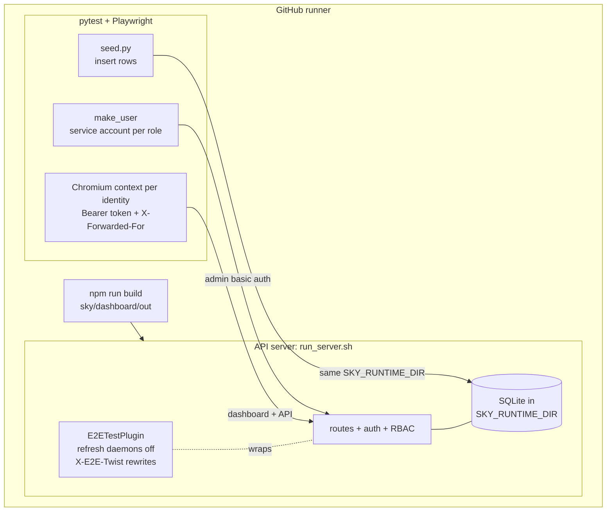
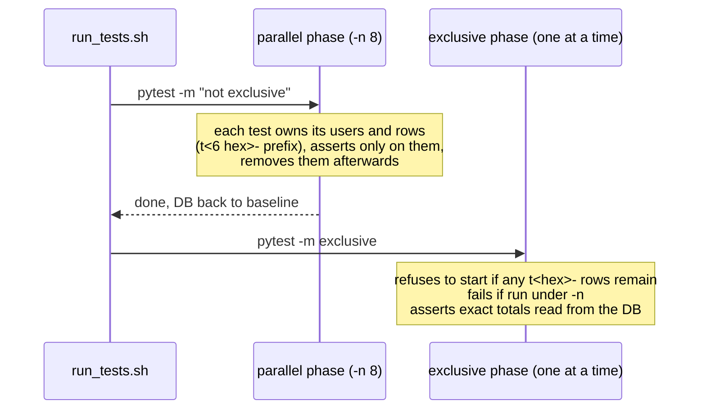
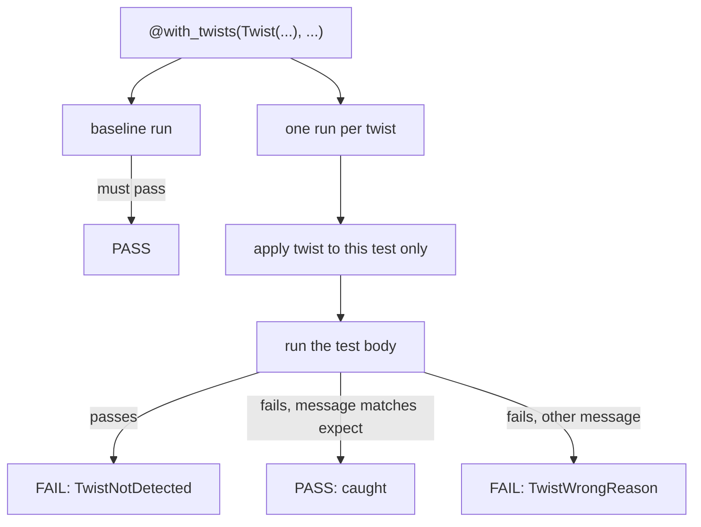

# Dashboard e2e tests

Browser tests for the SkyPilot dashboard. They drive the real built dashboard
in Chromium against one real API server, with data written straight into the
server's DB. Nothing launches on a cloud, so the suite runs on a plain GitHub
runner.

Every test proves it can fail: it declares *twists*, deliberate regressions it
must catch, and CI checks that each twist makes the test fail with the message
the twist names.

## Layout

```
tests/dashboard_e2e/
├── framework/              # reusable by any suite (another repo can import it)
│   ├── fixtures.py         # pytest plugin: identities, browser, recorder, verdicts
│   ├── twists.py           # Twist, @with_twists, req/res/dom twist helpers
│   ├── seed.py             # write rows into the server DB, count them, clean up
│   ├── server_plugin.py    # API server test plugin: daemons off, server twists
│   ├── run_server.sh       # start/stop an isolated server
│   ├── run_tests.sh        # parallel phase, then exclusive phase
│   └── run_src_twists.sh   # apply each source patch, prove it, revert
├── conftest.py             # loads framework.fixtures
├── plugins.yaml            # the server loads only the test plugin
├── server_twists.py        # this suite's server twists
├── twist_patches/          # this suite's source twists (src-<name>.patch)
└── test_*.py
```

## How it fits together



- **Server.** `run_server.sh` starts an API server with its own
  `SKY_RUNTIME_DIR`, an empty kubeconfig, consolidation mode for managed jobs
  (the queue reads the local DB, no controller cluster) and basic auth plus
  service accounts, so RBAC is real.
- **Test plugin.** `server_plugin.py` turns off the cluster/volume/serve/pool
  refresh daemons, so seeded rows are not reconciled against infra that does
  not exist, and serves header-scoped server twists.
- **Data.** Tests write rows with `seed.py` into the same SQLite files the
  server reads. Managed jobs are seeded with no controller pid and never in a
  scheduler state the recovery path relaunches.
- **Identities.** `make_user('viewer', role='viewer')` creates a service
  account; `open_as(user, path)` opens a browser context that sends its Bearer
  token. Every request also carries `X-Forwarded-For`, because requests from
  127.0.0.1 otherwise skip auth.

## Concurrency



- A normal test asserts only on what it created, so it runs in parallel with
  every other normal test.
- A test that asserts global state ("N jobs in total", "1 – 10 of N", status
  counts, what lands on the first page) is marked `@pytest.mark.exclusive` and
  runs alone after the parallel phase. Expected numbers come from the DB.

## Twists



| Layer | What it changes | Scope |
|---|---|---|
| `req` | a request the browser sends (`rewrite_request`) | this test's browser context |
| `res` | a response before the page sees it (`rewrite_response`) | this test's browser context |
| `dom` | the rendered page: remove an element, swallow a click | this test's browser context |
| `srv` | server behaviour, via `X-E2E-Twist` and `register_body_twist` | this test's requests |
| `src` | a real source patch, `twist_patches/<name>.patch`, id `src-<name>` | the whole server; run by `run_src_twists.sh` |

Name the assertion a twist should trip in `expect`, and give every assertion
a message: `expect(locator, 'View all jobs must switch the URL to owner=all')`.
A twist whose expect matches only "Timeout" proves little.

Every test must declare at least one twist; collection fails otherwise.

Write a source twist as a small patch against the repository root:
`git diff -U1 <file> > twist_patches/<name>.patch`. One line of context keeps
blank context lines (a lone space, which the whitespace hook strips) out of
the file; `run_src_twists.sh` applies patches with `--ignore-whitespace` as a
backstop.

## Run locally

```bash
pip install pytest pytest-xdist pytest-playwright
python -m playwright install chromium
npm --prefix sky/dashboard ci && npm --prefix sky/dashboard run build

cd tests/dashboard_e2e
framework/run_server.sh start > /tmp/e2e-env.sh && source /tmp/e2e-env.sh
framework/run_tests.sh            # baseline + req/res/dom/srv twists
framework/run_server.sh stop
framework/run_src_twists.sh       # src twists: patch, restart, prove, revert
```

A failing test leaves a Playwright trace and screenshots under
`test-results/` (`playwright show-trace <file>`).

## Reusing the framework from another suite

A suite elsewhere (for example a repository that loads extra server plugins)
puts this directory on `sys.path`, loads `framework.fixtures` from its
conftest, and starts the server with its own `E2E_SUITE_DIR`,
`E2E_PLUGINS_CONFIG` (listing `framework.server_plugin.E2ETestPlugin` among
its plugins) and `E2E_SERVER_TWIST_MODULES`.
